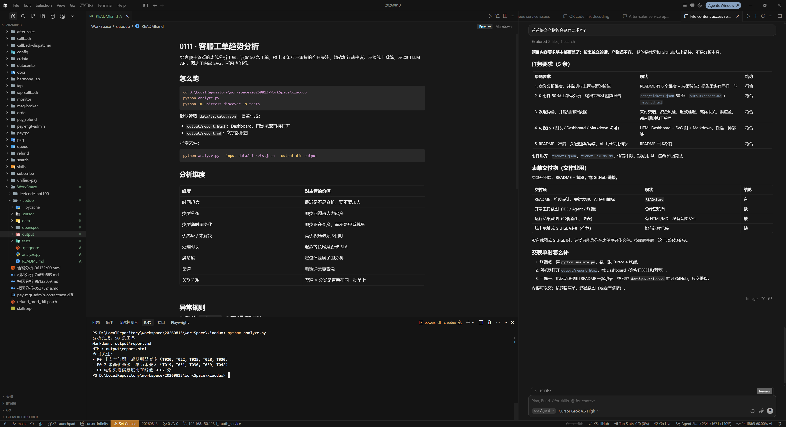
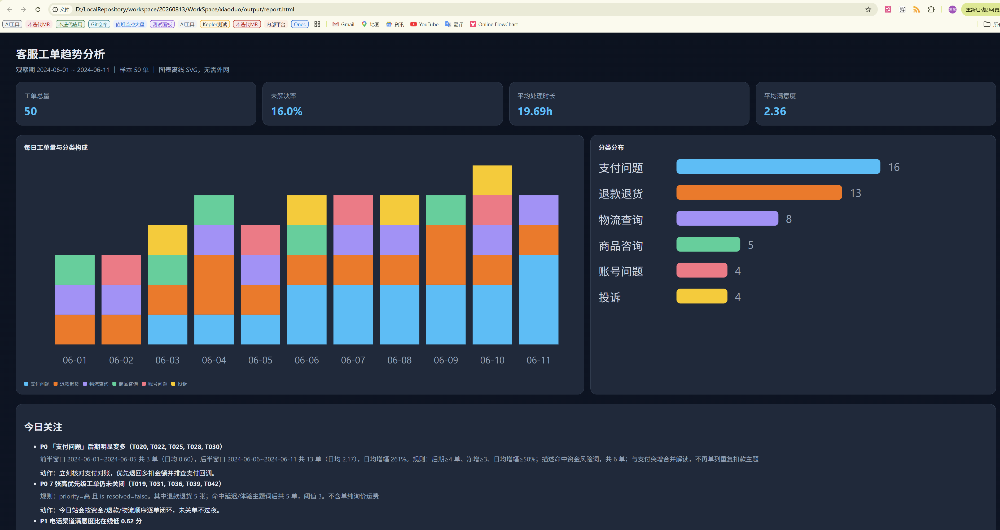

# 0111 · 客服工单趋势分析

仓库：[https://github.com/Ustain/WorkSpace/tree/main/xiaoduo](https://github.com/Ustain/WorkSpace/tree/main/xiaoduo)

给客服主管看的离线分析工具：读取 50 条工单，输出 3 条互不重复的今日关注、趋势和行动建议。不接线上系统，不调用 LLM API。图表用内嵌 SVG，断网也能看。

## 怎么跑

```bash
python analyze.py
python -m unittest discover -s tests
```

默认读取 `data/tickets.json`，覆盖生成：

- `output/report.html`：Dashboard，用浏览器直接打开
- `output/report.md`：文字版报告

指定文件：

```bash
python analyze.py --input data/tickets.json --output-dir output
```

## 分析维度

| 维度 | 对主管的价值 |
|---|---|
| 时间趋势 | 最近是不是变忙，要不要加人 |
| 类型分布 | 哪类问题占人力最多 |
| 类型随时间变化 | 哪类正在变多，而不是只看总量 |
| 优先级 / 未解决 | 高优积压必须今日盯 |
| 处理时长 | 退款等长尾是否卡 SLA |
| 满意度 | 定位体验崩了的分类 |
| 渠道 | 电话通常更紧急 |
| 关联关系 | 渠道 × 分类是否叠在同一批单上 |

## 异常规则

规则写在 `analyze.py`，报告里带判断依据：

- **分类突增**：后期 ≥ 4 单、净增 ≥ 3、日均增幅 ≥ 50%。1 单变 3 单这种小样本不报。
- **资金风险**：重复扣款 / 多扣。与支付突增合成一条支付结论，不再并列两条 P0。
- **退款延迟**：主题词要求「还没退 / 审核中 / 垫付了」等，单纯问运费谁出不计入。
- **高优未解决**：`priority=高` 且未关闭。
- **低满意度**：只取均分 ≤ 2.0 的最差 2 类，避免整体分偏低时全面亮红灯。
- **渠道关联**：电话满意度比在线低 ≥ 0.4 分才报。
- **今日关注**：按支付 / 退款 / 渠道三条主题去重，最多 3 条。

## 关键发现（基于附件 50 单）

1. **支付链路**：后期日均从 0.60 升到 2.17（+261%），并出现 6 单重复扣款/多扣（含 T050 订单 199 实扣 299）。
2. **退款积压**：7 张高优未关里 5 张是退款；延迟主题 5 单，不含运费询价误报。
3. **电话渠道更差**：电话均分 1.94，在线 2.56，差 0.62。电话进线应优先人工，尤其是退款/物流。

投诉从 1 单到 3 单不再当成「突增」。低满意度只保留投诉 1.0，不再把支付/物流/退款一起刷红。

## 截图

### 开发过程

Cursor 终端中运行分析与单测：



### 运行结果

浏览器打开 `output/report.html` 后的 Dashboard：



完整报告也可直接看 [output/report.html](./output/report.html) 和 [output/report.md](./output/report.md)。

## 交付物

- GitHub：[https://github.com/Ustain/WorkSpace/tree/main/xiaoduo](https://github.com/Ustain/WorkSpace/tree/main/xiaoduo)
- README：分析维度、关键发现、AI 工具使用情况
- 开发工具截图：`Cursor终端截图.png`
- 运行结果截图：`运行结果截图.png`
- 分析输出：`output/report.html`、`output/report.md`

## AI 工具使用情况

- 用 Cursor 读取飞书测评文档和附件
- 先用 OpenSpec 把规格写清，再实现；本轮按评分意见收紧告警
- 分析逻辑是规则统计，没有把工单丢给外部大模型打分
